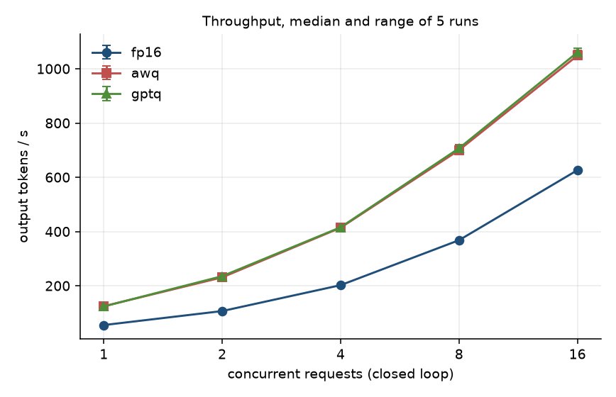
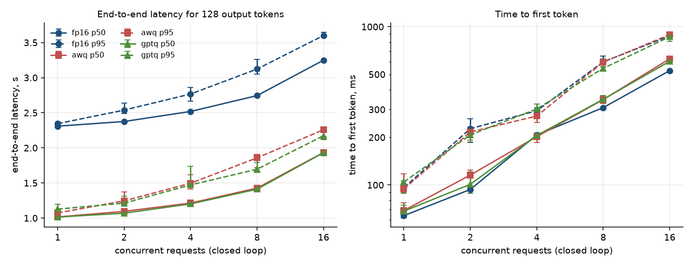
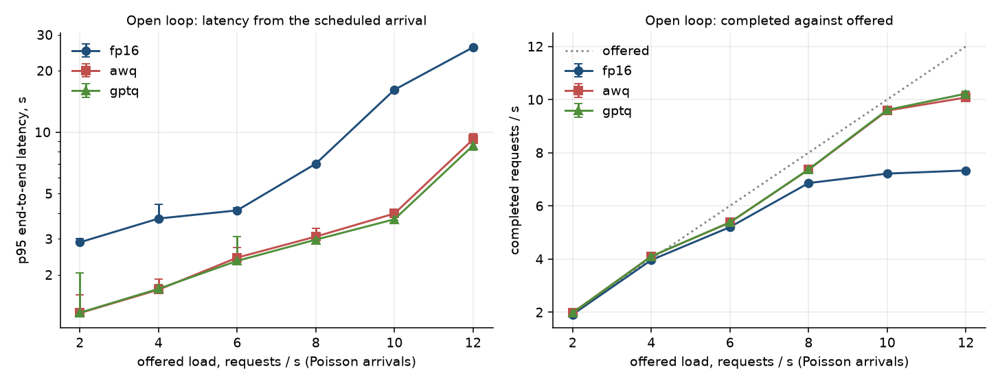
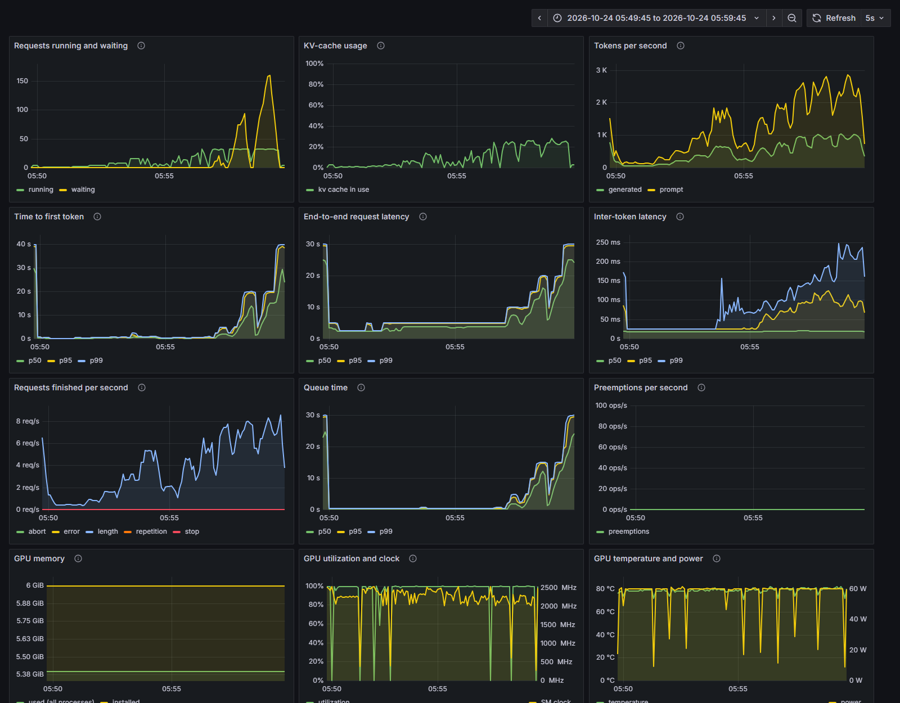

# vllm-serving-bench

A small open-weights language model served from the 6 GB GPU in my laptop with
vLLM, plus the tools I used to measure it: an async load harness, a fixed set
of questions with scripted scoring, and a Prometheus and Grafana stack that
watches the server while it runs.

I built it to see how a model server behaves under load on a small card: how
throughput and latency change as more requests arrive, where the server stops
scaling, and what 4-bit weights buy and cost compared with 16-bit weights.

**The load prompts are synthetic**: made-up documents built from a word list
with a seeded random generator. The quality questions are 285 from the public
MMLU test set and 120 generated ones (see [Quality set](#quality-set)). Every
number below was measured on one Windows 11 laptop; none of it says anything
about other GPUs.

## What it does

```
load harness ──HTTP──> vLLM :8000 ──/metrics──┐
                                              ├─> Prometheus ─> Grafana
nvidia-smi ──> gpu-exporter :9835 ────────────┘
```

| piece | what it does | host port |
|---|---|---|
| vLLM (`vllm/vllm-openai:v0.32.0`) | serves one model at a time through the OpenAI-compatible API; one Compose profile per precision arm | 18480 |
| gpu-exporter | publishes GPU memory, utilization, clock, temperature and power from `nvidia-smi` | none |
| Prometheus | scrapes the server and the exporter every 5 s | 18490 |
| Grafana | dashboard "vLLM serving", provisioned from `observability/grafana/` | 18491 |
| `servebench` | the load harness, quality runner and results summary (`src/servebench/`) | |

Three precision arms of one model, all from the Qwen organisation's own
repositories (Apache-2.0, not gated), pinned to a commit hash in
[`arms.json`](arms.json):

| arm | repository | weights |
|---|---|---|
| `fp16` | `Qwen/Qwen2.5-1.5B-Instruct` | 16-bit (the repository's bfloat16 weights, cast to float16) |
| `awq` | `Qwen/Qwen2.5-1.5B-Instruct-AWQ` | 4-bit AWQ |
| `gptq` | `Qwen/Qwen2.5-1.5B-Instruct-GPTQ-Int4` | 4-bit GPTQ |

I did not quantize anything myself. Why this model and the design of the
measurements: [docs/design.md](docs/design.md).

## Results

<!-- results:start -->

<!-- generated by scripts/render_readme_results.py; do not edit by hand -->

Median of 5 runs with the range (min-max) in brackets, from [`results/summary.json`](results/summary.json). The full tables, with pooled percentiles, are in [`results/summary.md`](results/summary.md).

### At a glance

| | fp16 | awq | gptq |
|---|---|---|---|
| weights in GPU memory, GiB | 2.98 | 1.10 | 1.10 |
| KV cache that fits, tokens | 54,352 | 127,280 | 126,752 |
| output tokens/s, 1 worker | 55.1 (55.0-55.2) | 124.5 (122.0-124.7) | 123.7 (122.3-126.4) |
| output tokens/s, 16 workers | 626.1 (625.7-627.6) | 1048.5 (1034.6-1067.3) | 1060.5 (1052.1-1076.8) |
| end-to-end p50 for 128 tokens, 1 worker, s | 2.31 (2.31-2.31) | 1.02 (1.01-1.03) | 1.01 (1.00-1.03) |
| end-to-end p50, 16 workers, s | 3.25 (3.25-3.26) | 1.93 (1.91-1.95) | 1.93 (1.88-1.94) |
| time to first token p50, 16 workers, ms | 528 (522-531) | 627 (611-642) | 605 (592-626) |
| closed-loop saturation | not reached by 16 workers (peak 626 tok/s) | not reached by 16 workers (peak 1049 tok/s) | not reached by 16 workers (peak 1061 tok/s) |
| open loop: requests start to wait at | 8 req/s offered | 12 req/s offered | 12 req/s offered |
| open loop: most completed at any tested rate | 7.33 req/s (938 tok/s), at 12 offered | 10.08 req/s (1290 tok/s), at 12 offered | 10.22 req/s (1308 tok/s), at 12 offered |
| MMLU subset accuracy, 285 questions, % | 58.6 (58.6-58.6) | 56.8 (56.5-56.8) | 57.5 (57.5-57.5) |
| synthetic tasks accuracy, 120 items, % | 95.8 (95.8-95.8) | 92.5 (92.5-92.5) | 85.0 (85.0-85.0) |

### Closed loop

**fp16**

| workers | output tok/s | req/s | TTFT p50 ms | TTFT p95 ms | e2e p50 s | e2e p95 s | e2e p99 s | GPU memory peak MiB |
|---|---|---|---|---|---|---|---|---|
| 1 | 55.1 (55.0-55.2) | 0.43 (0.43-0.43) | 64 (62-66) | 96 (92-102) | 2.31 (2.31-2.31) | 2.35 (2.34-2.35) | 2.59 (2.51-2.67) | 5523 (5359-5523) |
| 2 | 106.7 (105.9-106.8) | 0.83 (0.83-0.83) | 94 (93-95) | 227 (185-262) | 2.38 (2.37-2.38) | 2.54 (2.49-2.64) | 2.69 (2.58-2.91) | 5523 (5359-5523) |
| 4 | 202.2 (201.6-202.9) | 1.58 (1.57-1.59) | 207 (201-208) | 294 (263-307) | 2.52 (2.52-2.52) | 2.77 (2.66-2.86) | 2.82 (2.70-2.92) | 5523 (5453-5523) |
| 8 | 367.9 (366.9-368.6) | 2.87 (2.87-2.88) | 308 (299-309) | 600 (593-653) | 2.74 (2.74-2.75) | 3.12 (3.05-3.26) | 3.15 (3.07-3.28) | 5523 (5523-5523) |
| 16 | 626.1 (625.7-627.6) | 4.89 (4.89-4.90) | 528 (522-531) | 875 (864-887) | 3.25 (3.25-3.26) | 3.60 (3.58-3.65) | 3.65 (3.62-3.70) | 5523 (5523-5523) |

**awq**

| workers | output tok/s | req/s | TTFT p50 ms | TTFT p95 ms | e2e p50 s | e2e p95 s | e2e p99 s | GPU memory peak MiB |
|---|---|---|---|---|---|---|---|---|
| 1 | 124.5 (122.0-124.7) | 0.97 (0.95-0.97) | 69 (66-77) | 95 (90-117) | 1.02 (1.01-1.03) | 1.07 (1.05-1.10) | 1.27 (1.17-1.43) | 5559 (5395-5559) |
| 2 | 230.9 (225.2-237.1) | 1.80 (1.76-1.85) | 116 (96-125) | 216 (193-232) | 1.10 (1.07-1.11) | 1.24 (1.20-1.37) | 1.35 (1.32-1.55) | 5559 (5395-5559) |
| 4 | 413.8 (411.7-425.5) | 3.23 (3.22-3.32) | 202 (186-209) | 273 (248-326) | 1.21 (1.18-1.22) | 1.50 (1.41-1.62) | 1.55 (1.44-1.69) | 5559 (5489-5559) |
| 8 | 700.0 (694.2-720.1) | 5.47 (5.42-5.63) | 347 (327-363) | 597 (555-626) | 1.43 (1.39-1.44) | 1.86 (1.71-1.91) | 1.86 (1.72-1.91) | 5559 (5559-5559) |
| 16 | 1048.5 (1034.6-1067.3) | 8.19 (8.08-8.34) | 627 (611-642) | 892 (857-924) | 1.93 (1.91-1.95) | 2.26 (2.16-2.30) | 2.31 (2.18-2.32) | 5559 (5559-5559) |

**gptq**

| workers | output tok/s | req/s | TTFT p50 ms | TTFT p95 ms | e2e p50 s | e2e p95 s | e2e p99 s | GPU memory peak MiB |
|---|---|---|---|---|---|---|---|---|
| 1 | 123.7 (122.3-126.4) | 0.97 (0.96-0.99) | 68 (63-75) | 104 (89-106) | 1.01 (1.00-1.03) | 1.13 (1.04-1.20) | 1.42 (1.15-1.44) | 5561 (5397-5561) |
| 2 | 235.3 (232.2-236.2) | 1.84 (1.81-1.85) | 101 (89-121) | 207 (187-223) | 1.07 (1.05-1.08) | 1.21 (1.19-1.31) | 1.32 (1.28-1.56) | 5561 (5397-5561) |
| 4 | 415.5 (408.8-421.1) | 3.25 (3.19-3.29) | 205 (197-213) | 303 (276-324) | 1.20 (1.19-1.22) | 1.47 (1.44-1.73) | 1.51 (1.45-1.83) | 5561 (5491-5561) |
| 8 | 706.8 (702.4-717.8) | 5.52 (5.49-5.61) | 348 (340-368) | 546 (530-561) | 1.41 (1.40-1.43) | 1.70 (1.65-1.79) | 1.73 (1.66-1.80) | 5561 (5561-5561) |
| 16 | 1060.5 (1052.1-1076.8) | 8.29 (8.22-8.41) | 605 (592-626) | 864 (810-881) | 1.93 (1.88-1.94) | 2.17 (2.12-2.28) | 2.25 (2.13-2.35) | 5561 (5561-5561) |





### Open loop

**fp16**

| offered req/s | arrivals per second (realized) | completed req/s | completed % | TTFT p50 ms | e2e p50 s | e2e p95 s | e2e p99 s | unfinished |
|---|---|---|---|---|---|---|---|---|
| 2 | 2.00 (2.00-2.00) | 1.91 (1.91-1.91) | 100 (100-100) | 109 (107-124) | 2.63 (2.62-2.70) | 2.88 (2.87-3.01) | 2.94 (2.93-3.12) | 0 (0-0) |
| 4 | 4.10 (4.10-4.10) | 3.96 (3.96-3.96) | 100 (100-100) | 117 (112-158) | 2.99 (2.99-3.23) | 3.77 (3.75-4.43) | 3.84 (3.83-4.54) | 0 (0-0) |
| 6 | 5.47 (5.47-5.47) | 5.20 (5.20-5.20) | 100 (100-100) | 132 (131-140) | 3.62 (3.62-3.66) | 4.13 (4.13-4.25) | 4.27 (4.26-4.37) | 0 (0-0) |
| 8 | 7.55 (7.55-7.55) | 6.86 (6.86-6.87) | 100 (100-100) | 1605 (1588-1617) | 5.71 (5.69-5.73) | 7.00 (6.97-7.03) | 7.31 (7.28-7.35) | 0 (0-0) |
| 10 | 10.07 (10.07-10.07) | 7.21 (7.20-7.23) | 100 (100-100) | 6874 (6787-6934) | 11.03 (10.98-11.10) | 16.11 (15.98-16.25) | 16.65 (16.54-16.77) | 0 (0-0) |
| 12 | 12.00 (12.00-12.00) | 7.33 (7.30-7.34) | 100 (100-100) | 11972 (11914-12076) | 16.15 (16.09-16.23) | 26.02 (25.93-26.28) | 27.70 (27.63-28.00) | 0 (0-0) |

**awq**

| offered req/s | arrivals per second (realized) | completed req/s | completed % | TTFT p50 ms | e2e p50 s | e2e p95 s | e2e p99 s | unfinished |
|---|---|---|---|---|---|---|---|---|
| 2 | 2.00 (2.00-2.00) | 1.98 (1.97-1.98) | 100 (100-100) | 86 (81-97) | 1.17 (1.14-1.22) | 1.30 (1.28-1.60) | 1.48 (1.34-1.88) | 0 (0-0) |
| 4 | 4.10 (4.10-4.10) | 4.10 (4.10-4.10) | 100 (100-100) | 96 (90-100) | 1.37 (1.33-1.41) | 1.69 (1.66-1.90) | 1.86 (1.71-2.02) | 0 (0-0) |
| 6 | 5.47 (5.47-5.47) | 5.38 (5.38-5.38) | 100 (100-100) | 104 (102-116) | 1.62 (1.59-1.71) | 2.42 (2.31-2.71) | 2.54 (2.46-2.95) | 0 (0-0) |
| 8 | 7.55 (7.55-7.55) | 7.36 (7.36-7.37) | 100 (100-100) | 134 (123-148) | 2.13 (2.00-2.33) | 3.07 (3.03-3.36) | 3.19 (3.17-3.57) | 0 (0-0) |
| 10 | 10.07 (10.07-10.07) | 9.58 (9.53-9.59) | 100 (100-100) | 244 (213-297) | 3.12 (3.09-3.13) | 3.99 (3.86-4.17) | 4.28 (4.11-4.43) | 0 (0-0) |
| 12 | 12.00 (12.00-12.00) | 10.08 (9.95-10.29) | 100 (100-100) | 3703 (3199-3733) | 6.68 (6.15-6.84) | 9.21 (8.27-9.80) | 9.99 (8.94-10.49) | 0 (0-0) |

**gptq**

| offered req/s | arrivals per second (realized) | completed req/s | completed % | TTFT p50 ms | e2e p50 s | e2e p95 s | e2e p99 s | unfinished |
|---|---|---|---|---|---|---|---|---|
| 2 | 2.00 (2.00-2.00) | 1.98 (1.98-1.98) | 100 (100-100) | 86 (83-96) | 1.15 (1.14-1.18) | 1.30 (1.28-2.04) | 1.38 (1.31-2.28) | 0 (0-0) |
| 4 | 4.10 (4.10-4.10) | 4.10 (4.10-4.10) | 100 (100-100) | 94 (89-106) | 1.36 (1.32-1.44) | 1.71 (1.66-1.78) | 1.86 (1.72-1.96) | 0 (0-0) |
| 6 | 5.47 (5.47-5.47) | 5.38 (5.37-5.38) | 100 (100-100) | 104 (96-112) | 1.62 (1.56-1.70) | 2.34 (2.26-3.06) | 2.46 (2.44-3.24) | 0 (0-0) |
| 8 | 7.55 (7.55-7.55) | 7.37 (7.35-7.37) | 100 (100-100) | 116 (111-132) | 1.99 (1.95-2.14) | 2.97 (2.94-3.01) | 3.11 (3.06-3.14) | 0 (0-0) |
| 10 | 10.07 (10.07-10.07) | 9.61 (9.55-9.62) | 100 (100-100) | 193 (191-227) | 3.02 (2.97-3.08) | 3.74 (3.69-3.81) | 3.93 (3.87-4.09) | 0 (0-0) |
| 12 | 12.00 (12.00-12.00) | 10.22 (10.08-10.32) | 100 (100-100) | 3363 (3173-3684) | 6.34 (6.10-6.80) | 8.59 (8.13-9.20) | 9.25 (8.85-9.83) | 0 (0-0) |



### Quality

| arm | all 405 | mmlu-subset | synthetic-tasks |
|---|---|---|---|
| fp16 | 69.6 (69.6-69.6) | 58.6 (58.6-58.6) | 95.8 (95.8-95.8) |
| awq | 67.4 (67.2-67.4) | 56.8 (56.5-56.8) | 92.5 (92.5-92.5) |
| gptq | 65.7 (65.7-65.7) | 57.5 (57.5-57.5) | 85.0 (85.0-85.0) |

Paired against fp16, on the questions each arm got right in most of its runs (exact McNemar test on the questions where they differ):

| arm | both right | only fp16 right | only this arm right | both wrong | p |
|---|---|---|---|---|---|
| awq | 255 | 27 | 18 | 105 | 0.233 |
| gptq | 245 | 37 | 21 | 102 | 0.048 |

Questions whose result changed between runs of the same arm: awq 1, fp16 0, gptq 0.

<!-- results:end -->

### What I read from these

- **4-bit weights more than double the speed of a single request and still help
  under load.** With one worker the 4-bit arms generate 124.5 (awq) and 123.7
  (gptq) tokens/s against 55.1 for fp16, and a 128-token answer takes a median
  1.02 s and 1.01 s against 2.31 s. At 16 workers the gap is smaller: 1048.5
  and 1060.5 tokens/s against 626.1, and 1.93 s against 3.25 s. Both 4-bit
  arms run on vLLM's Marlin kernel (each startup log says so) and they are
  within 2% of each other at every level.
- **The first token does not arrive sooner.** At one worker all three arms
  take 64 to 69 ms to the first token. At 16 workers it is 528 ms for fp16
  against 627 ms (awq) and 605 ms (gptq). I did not look into why.
- **No arm stops scaling by 16 workers.** fp16 goes from 367.9 tokens/s at 8
  workers to 626.1 at 16, and the server accepts up to 32 requests at once, so
  the closed loop ends before the ceiling. The open loop finds it: at the
  highest rate tested (12 requests/s offered) fp16 completed 7.33 requests/s
  (938 tokens/s), awq 10.08 (1290 tokens/s) and gptq 10.22 (1308 tokens/s).
  Requests start to wait for a slot, meaning the median time to first token
  passes 1 s, at 8 requests/s offered for fp16 (1605 ms, against 132 ms at 6)
  and at 12 for awq and gptq (3703 and 3363 ms, against 244 and 193 ms at 10).
- **Memory.** The weights take 2.98 GiB in fp16 and 1.10 GiB in both 4-bit
  arms. What is left for the KV cache at start-up held 54,352 tokens for fp16
  and 127,280 and 126,752 for awq and gptq, about 2.3 times as many (these are
  warm-cache starts; see [the note on cold starts](results/exploratory/cold-first-starts/README.md)).
  Memory in use on the card was 5523 MiB (fp16) against 5559 and 5561 MiB at
  16 workers, because vLLM reserves a fixed share of the card (0.80) either way.
- **Quality.** On the 285 MMLU questions fp16 got 58.6%, awq 56.8% and gptq
  57.5%; on the 120 generated items 95.8%, 92.5% and 85.0%. The MMLU gaps
  (1.8 and 1.1 points) are about what 285 questions can show. The paired test
  over all 405 questions gives p = 0.233 for awq and p = 0.048 for gptq. The
  generated items show where gptq lost most: repeating an exact text 71.4%
  against 92.9%, writing a stated number of lines 76.9% against 100.0%, and
  extraction 87.5% against 100.0%
  ([`results/summary.md`](results/summary.md) has every kind). It is one model
  and 120 generated items, so I would not generalise it.
- **Repeatability.** The scored answers were identical in all five runs for
  fp16 and gptq; for awq one question changed result between runs.

### The dashboard during a run



fp16 run 3, from 10:49:45 to 10:59:45 UTC (Grafana labels the time in the
machine's local time, UTC-5). The closed-loop levels are the first half; the
queue of waiting requests (top left) and the time to first token build up in the
last two open-loop stages, 10 and 12 requests/s. `results/evidence/<arm>-stack-check.json`
records that every query in the dashboard evaluated against Prometheus with data,
and that the tokens the server counted were within 2% of the tokens the harness
counted (the harness leaves out its 24-request warm-ups).

### What this does not show

- One laptop GPU that also drives the display, one model family, prompts of
  100 to 400 words and answers of exactly 128 tokens. No other model, GPU, prompt
  length or output length was tried, and fp8 was not tried.
- The closed loop stops at 16 workers; the open loop stops at 12 requests/s, 40 s
  per rate. A per-run p99 rests on 32 to 256 requests in the closed loop and 80
  to 480 in the open loop; the pooled percentiles in `results/summary.md` use
  all five runs.
- The machine was shared. Other projects measured on it during the day, and a
  lock file kept the timed passes from overlapping. fp16 run 1 took the lock for
  its own pass; fp16 runs 2 to 5 and the awq runs shared one hold each; the gptq
  runs, its server start and its quality runs share another. The fp16 and awq
  servers were started, and the fp16 quality runs were done, outside a hold.
- Windows was on the Balanced power plan and plugged in (`results/environment.json`).
  The GPU's clocks and temperature were sampled with every level and are in the run files.

## Running it

Needs Docker with GPU support (the NVIDIA runtime), an NVIDIA GPU with 6 GB,
and Python 3.11 or newer for the harness. The first start of each arm downloads
the weights from Hugging Face (public repositories, no token).

```
python -m venv .venv
.venv/Scripts/pip install -e ".[dev,report]"      # .venv/bin/pip on Linux and macOS
docker compose --profile fp16 up -d --wait        # or awq, or gptq; one at a time
.venv/Scripts/python -m servebench.cli bench --arm fp16 --out results/try
docker compose down
```

Grafana is at http://127.0.0.1:18491 (anonymous read access), Prometheus at
http://127.0.0.1:18490. Only one arm can run at a time: they share port 18480
and the card does not have the memory for two.

`scripts/run_arm.py <arm> --runs 5 --open-rates 2,4,6,8,10,12` does everything
for one arm, the way the results here were produced: it starts the server, waits
for its health check, keeps the startup log, runs five timed passes (each begins
with an uncounted 24-request warm-up) and five quality runs, and checks the
dashboard against Prometheus. `--lock-file PATH` makes it wait for an exclusive
lock first and hold it throughout. `servebench summarize` turns the run files
into `results/summary.json`, `summary.md`, `runs.csv` and the plots, and
`scripts/render_readme_results.py` copies the results block into this file, so
no figure in it is typed by hand.

## How the numbers are produced

- **Closed loop.** 1, 2, 4, 8 and 16 workers, each sending its next request as
  soon as the last one finishes; `max(32, 16 x workers)` requests per level.
  Throughput is output tokens (or requests) divided by the time from the first
  send to the last completion.
- **Open loop.** Requests arrive as a Poisson process at a fixed rate whether or
  not the server keeps up, for 40 s per rate, and latency is measured from the
  scheduled arrival, so a slow server cannot hide its queue. After the last
  arrival the queue gets 60 s to drain; whatever is still unfinished is counted.
- **Every request** asks for exactly 128 new tokens (`ignore_eos`), so every
  arm does the same decode work. Prompts are 256 seeded synthetic documents of
  about 100 to 400 words, the same for every run and every arm.
- **Time to first token** is the first content chunk of the stream; end-to-end
  latency is the last chunk; both are percentiles per run, and the tables give
  the median of the 5 runs with the range in brackets. Per-request records are
  kept (`results/runs/<arm>/run-NN.requests.jsonl.gz`), so pooled percentiles
  over all five runs are in the summary too.
- **GPU memory** is sampled from `nvidia-smi` four times a second during every
  level. It is total memory in use on the card, desktop included. vLLM reserves
  its memory when it starts, so this figure barely moves with load; the
  per-arm differences are in how much of the reservation holds weights and how
  much holds the KV cache, from each arm's startup log
  (`results/server/<arm>/facts.json`).
- **Saturation.** In the closed loop an arm is saturated at the smallest worker
  count whose next level (double the workers) gains under 10% in tokens/s; none
  reached it by 16. In the open loop it is the lowest offered rate at which the
  median time to first token, measured from the scheduled arrival, is over 1 s
  (or any run leaves requests unfinished). I first wrote the open-loop rule as
  "p95 end-to-end latency doubles against the lowest rate" and changed it after
  the runs: it fired at 8 requests/s for all three arms, because the latency of
  one request also grows with the batch it runs in, before any request waits.
  Time to first token jumps from about 100 ms to seconds once a queue forms, so
  the threshold hardly matters. The tables show both latencies for every rate.
- **Shared machine.** Other projects were using the same laptop. Timed work takes
  an exclusive lock file first so two measurements do not overlap (`--lock-file`;
  `scripts/run_arm.py` holds it for a whole arm), and `docker ps` is saved beside
  each run file. Background load that is not locked (the desktop, idle
  containers) is still there; [What this does not show](#what-this-does-not-show)
  says which parts were outside a hold.
- **Prefix caching is off** (the five runs reuse the same prompts, and with
  caching on the later runs would skip the prompt work), and the server's
  `--generation-config vllm` ignores the sampling defaults in the model
  repository (a repetition penalty of 1.1, top-k 20, top-p 0.8), which the
  first start of the server was applying to every request.

### Quality set

Each arm answers the same 405 questions at temperature 0, five times, and a
script scores the replies (`src/servebench/quality.py`; no model judges
anything):

- `mmlu-subset`: 285 four-choice questions, 5 from each of the 57 MMLU
  subjects, drawn with a fixed seed from the test split of `cais/mmlu` (MIT
  licence, dataset revision `c30699e8356da336a370243923dbaf21066bb9fe`,
  downloaded 2026-10-24). A reply is right if the first A, B, C or D in it is
  the answer. [`quality/mmlu_subset.source.json`](quality/mmlu_subset.source.json)
  has the URL, the hash of the download and the seed.
- `synthetic-tasks`: 120 generated items: 40 integer arithmetic questions, 40
  extractions of one fact from a made-up order note, and 40 format-following
  items (exact text, a JSON object, a number of lines) checked by code. Generated
  by `scripts/make_synthetic_tasks.py` with a fixed seed.

Greedy decoding on a GPU is not bit-for-bit repeatable when batches differ, so
the tables give the range over the five runs and the number of questions whose
result changed between runs.

## Tests

```
.venv/Scripts/python -m ruff check .
.venv/Scripts/python -m pytest -q
```

No GPU is needed. The harness is tested against an in-process fake server that
streams server-sent events: percentiles and median/range, the stream parser,
the Poisson schedule, latency measured from the scheduled arrival, failures,
saturation, the lock file, the workload generator, the quality scorers (and a
check that each synthetic task's own answer scores as correct), the results
summary, the command line, the Compose file against `arms.json`, and that every
metric a dashboard panel queries appears in a snapshot taken from the real
server (`tests/fixtures/vllm-metrics-v0.32.0.txt`). `.github/workflows/ci.yml`
runs the same lint and tests on GitHub Actions, and checks the Compose profiles
and the Prometheus configuration. The measurements are not part of CI: they need
the GPU.

## Things that went wrong

- `vllm/vllm-openai:v0.32.0-cu129`, the first image I pulled (11 GB, about half
  an hour on this machine), does not start: `vllm serve` fails at import because
  its `torchcodec` needs `libnvrtc.so.13`, which a CUDA 12.9 image does not
  carry (`docs/notes/cu129-import-error.log`). The plain `v0.32.0` tag is the CUDA 13
  build and works with this driver (reports CUDA 13.1).
- The first start of the server printed that it was overriding vLLM's sampling
  defaults with the model repository's `generation_config.json`. That would
  have put a repetition penalty on every "temperature 0" request, so every
  arm now starts with `--generation-config vllm`.
- A unit test showed that counting open-loop completions only inside the arrival
  window under-counts under load, because requests that arrive late finish after
  the window. Open-loop throughput now uses the closed loop's basis: completed
  work over the time from the first arrival to the last completion.
- The open-loop saturation rule changed after I saw the data (see
  [How the numbers are produced](#how-the-numbers-are-produced)).
- The KV cache that fits at start-up is not a constant: the first starts, with an
  empty compile cache, gave 42,432 tokens for fp16, and the warm starts used for
  the runs gave 54,352 (`results/exploratory/cold-first-starts/`). The runs compare
  the arms at the same, warm, state.
- The other projects on the machine held the lock for 15 to 60 minutes at a time
  and took it again within two seconds of each other's release, so a harness
  polling every 2 s never got a turn. Mine polls every 50 ms and holds one lock
  per arm. `scripts/run_arm.py` first crashed on a Windows text-encoding error in
  the Docker logs, before any measurement; nothing from those attempts was kept.
- Smoke passes (4 workers, 24 requests, no lock) and the sizing passes that picked
  the open-loop rates are in `results/exploratory/`. They are not part of any
  table above.

## Repository layout

```
src/servebench/   load harness, quality runner, results summary, plots
quality/          the two question sets and where they came from
scripts/          arm runner, stack check, environment recorder, set builders
docker/           the GPU exporter image
observability/    Prometheus and Grafana configuration and the dashboard
tests/            unit tests and the metrics snapshot they check the dashboard against
results/          every run (JSON), per-request records, summary, evidence
docs/             design notes
```
